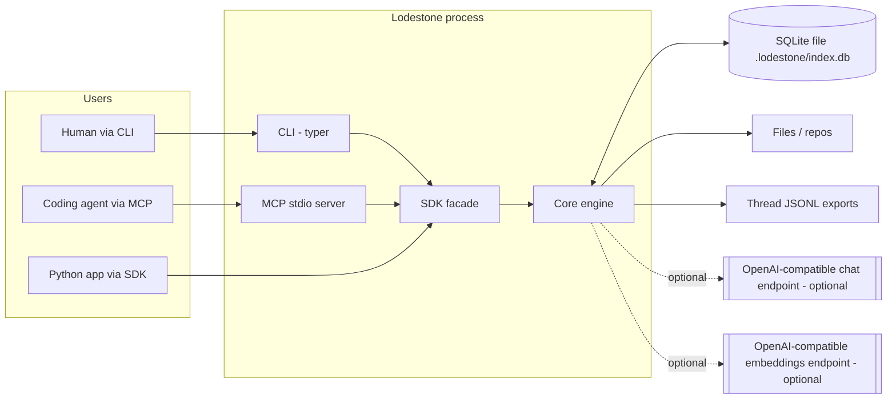
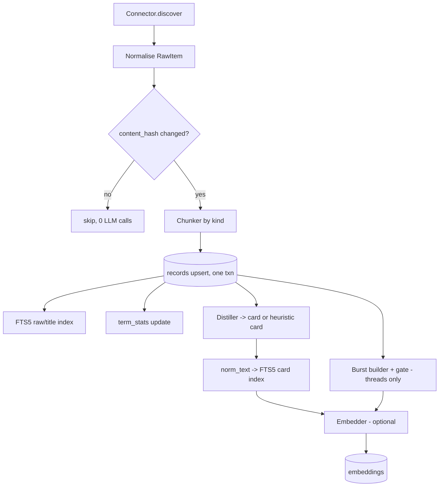
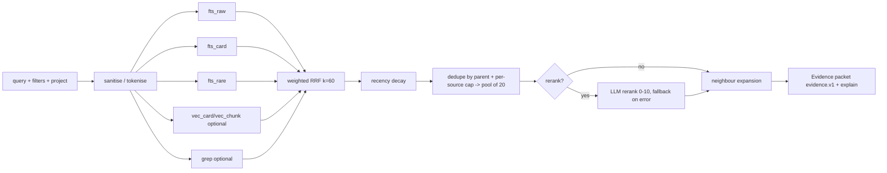
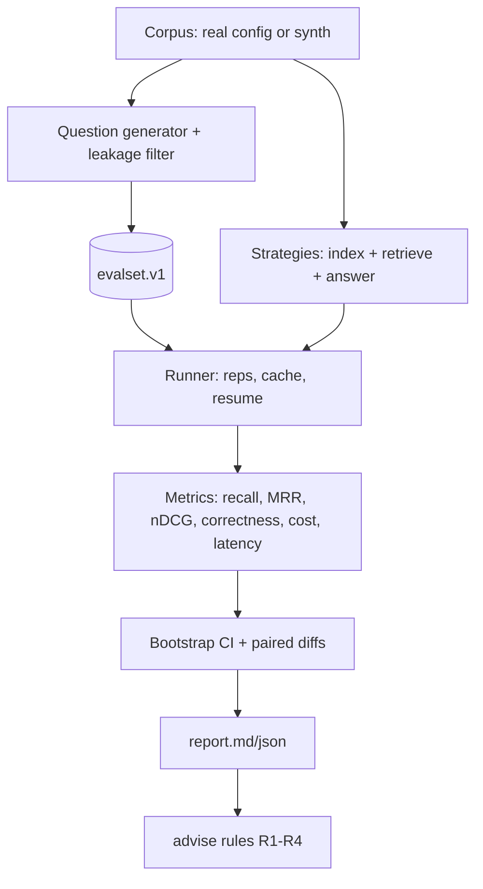

# 02 - Architecture: Lodestone

Version 1.0 - 2026-10-16. Implements `01-SRS.md`. Section numbers are referenced by the SRS traceability matrix.

## 1. System context



Principle ("narrow waist", from the Cerebras design): every source is reduced to one record shape; every retrieval capability is a lane returning ranked record ids; fusion, expansion and rerank are generic. The LLM is optional at ingest and query and never required for the primitives.

## 2. Data flow

### 2.1 Ingest

Per-record transaction: records row + FTS rows + term_stats delta + bursts commit together; card and embeddings are written in a second transaction keyed by the same `content_hash` so a crash between them leaves a searchable (lexical raw) record and a "pending derived" marker that the next `sync` completes.

### 2.2 Query (`search`)


### 2.3 `ask`
Question -> Planner (catalog + question -> tool calls JSON) -> Executor (asyncio fan-out of `search`/`grep`/`who_knows`/`recent`) -> Evidence normalisation (dedupe, global numbering) -> Sufficiency check (<= max_rounds) -> Synthesis (answer with `[n]` citations) -> Answer object.

## 3. Components and module boundaries

Package layout (`src/lodestone/`); each module has one responsibility and may import only downward (arrows in 3.13).

### 3.1 `config` - TOML config (pydantic v2)
```toml
# lodestone.toml - full schema with defaults
schema_version = 1
[workspace]
db_path = ".lodestone/index.db"
default_project = "default"

[llm]                      # optional; omit for offline
base_url = "https://api.cerebras.ai/v1"   # any OpenAI-compatible
model = "gpt-oss-120b"
api_key_env = "CEREBRAS_API_KEY"
timeout_s = 60
max_retries = 4
max_concurrency = 4
json_mode = true           # send response_format when true; tolerant parse always on
[llm.prices]               # USD per 1M tokens, optional, dated
input = 0.0
output = 0.0
as_of = "2026-10-16"

[embed]                    # optional
provider = "none"          # none | openai_compat | hash
base_url = "http://localhost:11434/v1"
model = "nomic-embed-text"
api_key_env = ""
dim = 768
source = "card"            # card | raw | both
batch_size = 64

[chunks]
target_tokens = 400
max_tokens = 800
chars_per_token = 4
contextualize = false      # FR-025

[cards]
enabled = true
kinds = ["thread", "doc", "code_file"]
prompt_version = "card.v1"
max_input_chars = 24000

[bursts]
idf_min = 4.0
min_chars = 200
w_idf = 1.0
w_len = 1.0
w_react = 1.0
threshold = 1.0

[retrieval]
lanes = ["fts_raw", "fts_card", "fts_rare", "vec_card", "vec_chunk", "grep"]  # vec_* skipped if no embeddings; grep opt-in per query
weights = { fts_raw = 1.0, fts_card = 1.0, fts_rare = 0.7, vec_card = 1.0, vec_chunk = 0.7, grep = 0.5 }
rrf_k = 60
candidate_pool = 20
max_per_source = 3
rerank = false
rerank_keep = 10
expand = 1
expand_max_chars = 4000
rare_idf = 4.0
[retrieval.decay]          # per record kind
thread = { half_life_days = 120, floor = 0.4 }
doc    = { half_life_days = 0 }     # 0 = disabled
code   = { half_life_days = 0 }

[ask]
max_rounds = 3
planner_model = ""         # defaults to llm.model
synth_model = ""

[log]
store_queries = false
level = "INFO"

[[sources]]
name = "wiki"
kind = "files"
path = "./docs"
include = ["**/*.md"]
exclude = ["drafts/**"]
refresh = "manual"
[[sources]]
name = "support"
kind = "threads"
path = "./exports/support.jsonl"
channel = "support"

[[projects]]
name = "default"
sources = ["wiki", "support"]
```
Validation: unknown keys rejected; `weights` keys must be known lanes; `chars_per_token >= 1`; paths resolved relative to the config file; secrets only via env var names.

### 3.2 `cli` - Typer app
Thin: parses args, builds `Lodestone` (SDK), prints human or `--json` output, maps exceptions to exit codes (0/1/2/3). No business logic.

### 3.3 `connectors` - sources to RawItem
```python
@dataclass(frozen=True)
class RawItem:
    ext_id: str            # stable id within the source (path, thread_id)
    kind_hint: str         # md|txt|code|thread
    title: str
    text: str              # full raw text (for threads: rendered transcript)
    messages: list[Message] | None   # threads only
    metadata: dict[str, str | int | float | bool]
    updated_at: datetime   # UTC
class Connector(Protocol):
    name: ClassVar[str]
    def discover(self, cfg: SourceConfig) -> Iterator[RawItem]: ...
```
Built-ins: `FilesConnector` (pathspec for .gitignore; root-jail check), `ThreadsConnector` (JSONL streaming; line-level error report). Plugin discovery by `importlib.metadata.entry_points(group="lodestone.connectors")`. Thread rendering: `[2026-07-01T09:14Z] maya: text` per message; bursts keep original message ids.

Chunkers (`chunking/`): `markdown.py` (heading tree -> paragraphs; returns sections with heading path and sibling links), `code.py` (language table of coarse->fine regexes; falls back to blank-line blocks), `window.py` (fixed windows, used only by the bench baseline).

### 3.4 `ingest` - pipeline
Orchestrates: discover -> hash check -> chunk -> upsert -> derived (cards, bursts, embeddings). Uses a bounded `ThreadPoolExecutor` for LLM/embedding calls (LLM calls are I/O bound; SQLite writes are serialised in the main thread through a single writer connection). Dry-run mode computes counts and estimated tokens only. Pruning removes tombstoned records and updates `term_stats` (df recount for affected terms).

### 3.5 `distill` - cards
`Distiller.card(record) -> Card` with `LLMDistiller` and `HeuristicDistiller`. Prompt template `prompts/card.v1.md` (checked in; hash recorded). Output JSON schema:
```json
{"question": "string <=200 chars", "summary": "string <=500", "resolution": "string <=500 or empty",
 "entities": ["<=8 strings"], "code_refs": ["<=12 strings"]}
```
Strategy: truncate input to `max_input_chars` (keep head + tail); parse JSON tolerant of code fences; validate; up to 2 retries with the validation error appended; fallback heuristic. Cache table `card_cache(key, card_json, method, created_at)`.
`norm_text` renderer: plain or XML (`<question>..</question>...`) per config.

### 3.6 `lanes` - ranked-list producers
Interface: `Lane.search(query: ParsedQuery, scope: Scope, limit: int) -> list[(record_id, raw_score)]`.
- `fts_raw`: `SELECT rowid, bm25(records_fts, 3.0, 1.0, 0.0) FROM records_fts WHERE records_fts MATCH :expr AND <scope join>`; the FTS table has columns `title, text, norm`; per-lane column filter (`{title text} : expr`).
- `fts_card`: column filter `{norm} : expr`.
- `fts_rare`: builds `expr` only from tokens with `idf(token) >= rare_idf` using `term_stats` (idf = ln(1 + (N - df + 0.5)/(df + 0.5))); skipped if none; note the IDF threshold 4.0 corresponds to terms appearing in roughly <2% of records for N=10,000 (document this; thresholds are corpus-size dependent so the config also accepts `rare_df_ratio`).
- `vec_*`: see 3.7.
- `grep`: Python `re` with timeout via `signal`-free approach (chunked scan with time budget) over `records.text`; `rg` accelerator for `files` sources.
Query parsing: unicode-aware lowercase tokenizer, stop-token list (small, configurable), quoted phrases preserved, identifier-like tokens (contain `_`, digits, camelCase, `-`) are marked `exact` and also searched as phrase.

### 3.7 `vectors` - optional embeddings
`Embedder` protocol; `HashEmbedder(dim=256)` (signed feature hashing of tokens + bigrams, L2-normalised: deterministic, **not semantic**); `OpenAICompatEmbedder`. Storage `embeddings(record_id, kind, model, dim, vec BLOB float32 little-endian)`. Search backends: `SqliteVecBackend` (virtual table `vec_index`, created lazily per (model,dim)) and `BruteForceBackend` (stdlib `array` + dot product; numpy used if installed). Both return cosine top-k; parity-tested.
Kinds: `card` (embeds `norm_text`), `chunk` (embeds raw chunk text, with `context_prefix` if any), `burst` (prefix + burst text).

### 3.8 `fusion` - RRF, decay, dedupe, expand
Pure functions over lists, no DB access except `expand`:
```python
def rrf(lists: dict[str, list[int]], weights: dict[str, float], k: int = 60) -> dict[int, FusedScore]
# score(d) = sum_l w_l / (k + rank_l(d)), rank starts at 1
def decay(score, updated_at, now, half_life_days, floor) -> float  # max(floor, 0.5 ** (age/half_life))
def collapse(parents, per_source_cap, pool) -> list[Hit]
def expand(hits, db, n, max_chars) -> list[Hit]
```
`explain` object per hit: `{lane: {rank, raw_score, contribution}}, rrf, decay_factor, rerank_score, final`.

### 3.9 `rerank`
`LLMReranker.rerank(query, hits) -> list[(id, score)]`; prompt gives numbered snippets (<=1,200 chars) with ids, asks for strict JSON; scores clamped 0-10; missing ids get 0; any exception -> fallback + notice; result is a permutation of the input pool (property tested). Sorting key: (rerank score desc, fused score desc).

### 3.10 `mcp_server` - MCP (stdio)
Tools (all read-only):
| Tool | Input | Output |
|---|---|---|
| `search` | `query:str, project?:str, kinds?:[str], sources?:[str], since?:date, until?:date, limit?:int=10, rerank?:bool=false, explain?:bool=false` | `{hits:[evidence.v1], notices:[str]}` |
| `grep` | `pattern:str, regex?:bool=false, project?:str, path_glob?:str, context?:int=2, limit?:int=20` | `{matches:[{record_id, uri, line, text, context}]}` |
| `get_record` | `id:int | ext_id:str, source?:str, include_card?:bool=true` | `{record, card, raw_text, children}` |
| `list_sources` | `project?:str` | `{projects, sources:[{name,kind,records,newest,oldest}]}` |
| `who_knows` | `topic:str, project?:str, limit?:int=5` | `{people:[{author, score, records}]}` |
| `recent` | `limit?:int=10, project?:str, since?:date` | `{hits:[evidence.v1]}` |
Server uses the official Python `mcp` SDK (`FastMCP`). Opened DB read-only (`mode=ro`) so MCP cannot mutate the index.

### 3.11 `ask` - agent pipeline
Planner prompt gets: question, catalog JSON (<=2k tokens: projects, sources with kind/count/date range, top 20 terms per source), tool specs. Returns `{"calls":[{"tool":"search","args":{...}}...]}`; validated; max 4 calls; unknown tools dropped; if empty -> default plan.
Executor: `asyncio.gather` over calls via thread offload; results normalised into global evidence list with ids `E1..En` (dedupe by record id; keep best score).
Sufficiency: cheap LLM call "SUFFICIENT or NEED:<query>"; loops until sufficient or `max_rounds`.
Synthesis: system prompt states evidence is untrusted data; evidence rendered as `<evidence id="E3" source=".." date="..">...</evidence>`; answer must cite `[E3]`; post-validator strips citations to non-existent ids and flags `unsupported_claims` when a sentence has no citation (heuristic).
Returns `Answer{text, citations[], rounds, plan, cost, insufficient_evidence}`.

### 3.12 `providers`
`ChatClient` (httpx, sync + async), `FakeChat`, `Embedder`s. Retry policy: 429/5xx/timeouts, exponential backoff (base 0.5 s, factor 2, jitter +-25%, max `max_retries`). Every call -> `llm_log` row. `OfflineGuard` swaps providers and raises `OfflineError` on remote attempts.

### 3.13 Dependency direction
`cli, mcp_server -> sdk -> {ingest, retrieval(ask, lanes, fusion, rerank), bench} -> {distill, vectors, chunking, connectors} -> {providers, storage, config, models}`. `bench` may import retrieval and ingest but not vice versa. No module imports `cli`. Enforced by an import-linter config in CI.

## 4. Public interfaces

### 4.1 SDK
```python
class Lodestone:
    @classmethod
    def open(cls, config: str | Path | Config = "lodestone.toml", *, offline: bool = False) -> "Lodestone": ...
    def sync(self, sources: list[str] | None = None, *, prune: bool = False, dry_run: bool = False) -> SyncReport: ...
    def search(self, query: str, *, project: str | None = None, kinds=None, sources=None, since=None, until=None,
               limit: int = 10, rerank: bool | None = None, decay: bool = True, explain: bool = False) -> SearchResult: ...
    def grep(self, pattern: str, *, regex: bool = False, project=None, path_glob=None, context: int = 2, limit: int = 20) -> GrepResult: ...
    def get(self, ref: int | str, *, source: str | None = None) -> Record: ...
    def who_knows(self, topic: str, *, project=None, limit: int = 5) -> list[Expert]: ...
    def recent(self, *, project=None, since=None, limit: int = 10) -> list[Hit]: ...
    def ask(self, question: str, *, project=None, max_rounds: int | None = None) -> Answer: ...
    def stats(self) -> Stats: ...
    def close(self) -> None: ...
```
`SearchResult{hits: list[Hit], notices: list[str], timing_ms: dict, cost: Cost}`; `Hit` = `evidence.v1` model.

### 4.2 CLI (examples and exit codes)
```
lodestone init
lodestone source add wiki --kind files --path ./docs --include "**/*.md"
lodestone sync [--prune] [--dry-run] [--refresh-cards] [--offline]
lodestone search "restore hangs after manifest load" --project default --limit 10 --explain --json
lodestone grep "ERR_[A-Z_]+" --regex --context 2
lodestone get 42
lodestone who-knows "checkpoint restore"
lodestone ask "Why does restore stall on NFS?"
lodestone mcp                      # stdio server
lodestone cost | stats | doctor [--deep]
lodestone bench synth --seed 42 --threads 300 --out ./bench/synth
lodestone bench generate --corpus ./lodestone.toml --n 200 --out evalset.jsonl
lodestone bench run --evalset evalset.jsonl --strategies all --reps 3 --out ./bench/run1
lodestone bench report ./bench/run1 ; lodestone bench advise ./bench/run1
```
Exit: 0 success; 1 runtime error; 2 usage/config; 3 provider error (after retries).

### 4.3 Schemas (files in `schemas/`)
`evidence.v1.json`, `evalset.v1.json`, `report.v1.json`, `config.v1.json` (generated from pydantic). Example `evidence.v1`:
```json
{"schema":"evidence.v1","id":42,"source":"support","kind":"thread","title":"Restore stalls after manifest load",
 "uri":"jsonl://support#thread_8f42","snippet":"Setting CKPT_PREFETCH=4 makes it complete...","score":0.0792,
 "lanes":{"fts_card":{"rank":1,"score":-3.2},"vec_card":{"rank":2}},"updated_at":"2026-07-01T09:21:00Z",
 "authors":["maya","owen"],"card":{"question":"Why does restore stall after manifest load?","summary":"...","resolution":"Set CKPT_PREFETCH=4 for the NFS mount.","entities":["checkpoint restore","NFS"],"code_refs":["CKPT_PREFETCH"]},
 "children":[{"id":97,"kind":"burst","snippet":"..."}],"neighbours":[],"explain":null}
```

## 5. Benchmark subsystem (`bench/`)

Isolation: each strategy builds its own index in a temp SQLite file (`strategy_<name>.db`) from the same corpus so baselines are not advantaged by Lodestone tables. Gold ids are `ext_id`s; chunk-level hits map to parent `ext_id` before metrics ("parent collapse") so strategies are comparable.
Strategy table (SRS FR-073) with configs:
| Strategy | Index | Retrieval | Needs |
|---|---|---|---|
| classic-rag | 512-token windows, overlap 64, embed raw | dense top-k | embedder |
| bm25-chunks | same windows | FTS5 BM25 | none |
| hybrid-chunks | same windows | BM25 + dense RRF k=60 | embedder |
| lodestone-lexical | records+cards | fts_raw+fts_card+fts_rare, decay, dedupe | none (heuristic or LLM cards) |
| lodestone-hybrid | + vec_card/vec_chunk | all lanes | embedder |
| lodestone-rerank | as hybrid | + LLM rerank | chat |
| agentic-ask | lodestone index | planner+loop (retrieval = union of cited evidence) | chat |
| grep-agent | raw files only | LLM loop with `grep`/`read` tools, max 8 tool calls | chat |
| full-context | raw text | whole corpus in prompt if <= budget | chat |
Statistics: percentile bootstrap, seed from run config hash. Costs: `tokens x price`. Latency measured wall-clock per query excluding index build.
Caveat generator inspects run config (hash embedder, FakeLLM, small N, leakage > 0.3) and writes plain-language warnings into report.

## 6. Operations and observability
- Logging: `logging` with JSON formatter when `LODESTONE_LOG=json`; fields `ts, level, op, duration_ms, ids`. Never logs raw record text or keys.
- Tables: `llm_log(op, model, in_tokens, out_tokens, latency_ms, ok, created_at)`, `query_log(qhash, project, lanes, results, latency_ms, created_at, query_text NULL)`.
- `doctor --deep` runs consistency checks: every non-tombstoned record has FTS row; term_stats df matches recount sample; embeddings dims uniform; no orphan children.
- Health of derived data: `records.derived_state` in {`pending`,`ok`,`failed`}; `stats` shows counts.

## 7. Storage design

### 7.1 DDL (schema version 1)
```sql
PRAGMA journal_mode=WAL; PRAGMA foreign_keys=ON; PRAGMA user_version=1;
CREATE TABLE meta(key TEXT PRIMARY KEY, value TEXT NOT NULL);
CREATE TABLE sources(id INTEGER PRIMARY KEY, name TEXT UNIQUE NOT NULL, kind TEXT NOT NULL, config_json TEXT NOT NULL,
  last_synced_at TEXT);
CREATE TABLE projects(id INTEGER PRIMARY KEY, name TEXT UNIQUE NOT NULL, description TEXT);
CREATE TABLE project_sources(project_id INTEGER REFERENCES projects(id) ON DELETE CASCADE,
  source_id INTEGER REFERENCES sources(id) ON DELETE CASCADE, PRIMARY KEY(project_id, source_id));
CREATE TABLE records(
  id INTEGER PRIMARY KEY,
  source_id INTEGER NOT NULL REFERENCES sources(id) ON DELETE CASCADE,
  ext_id TEXT NOT NULL,                 -- stable id inside source (path#section, thread_id, thread_id#burst3)
  parent_id INTEGER REFERENCES records(id) ON DELETE CASCADE,
  kind TEXT NOT NULL CHECK(kind IN ('doc','section','code_file','code','thread','burst')),
  seq INTEGER NOT NULL DEFAULT 0,       -- order among siblings (neighbour expansion)
  title TEXT NOT NULL DEFAULT '',
  text TEXT NOT NULL,                   -- raw text, verbatim
  context_prefix TEXT NOT NULL DEFAULT '',
  card_json TEXT,                       -- distilled card or NULL
  card_method TEXT,                     -- 'llm' | 'heuristic' | NULL
  norm_text TEXT NOT NULL DEFAULT '',   -- text indexed for fts_card / embedded
  author TEXT, authors_json TEXT,
  metadata_json TEXT NOT NULL DEFAULT '{}',
  content_hash TEXT NOT NULL,
  derived_state TEXT NOT NULL DEFAULT 'pending',
  created_at TEXT NOT NULL, updated_at TEXT NOT NULL,    -- UTC ISO-8601 of the upstream item
  indexed_at TEXT NOT NULL,
  tombstoned INTEGER NOT NULL DEFAULT 0,
  UNIQUE(source_id, ext_id)
);
CREATE INDEX records_parent ON records(parent_id, seq);
CREATE INDEX records_updated ON records(updated_at);
CREATE INDEX records_kind ON records(kind, source_id);
CREATE VIRTUAL TABLE records_fts USING fts5(title, text, norm, content='records', content_rowid='id',
  tokenize="unicode61 remove_diacritics 2 tokenchars '_-'");
-- triggers keep records_fts in sync (external-content table): AFTER INSERT/UPDATE/DELETE on records
CREATE TABLE term_stats(term TEXT PRIMARY KEY, df INTEGER NOT NULL);   -- df over non-tombstoned records of kinds doc/section/thread/code/code_file/burst
CREATE TABLE card_cache(key TEXT PRIMARY KEY, card_json TEXT NOT NULL, method TEXT NOT NULL, created_at TEXT NOT NULL);
CREATE TABLE embeddings(record_id INTEGER NOT NULL REFERENCES records(id) ON DELETE CASCADE,
  kind TEXT NOT NULL CHECK(kind IN ('card','chunk','burst')), model TEXT NOT NULL, dim INTEGER NOT NULL,
  vec BLOB NOT NULL, PRIMARY KEY(record_id, kind, model));
CREATE TABLE llm_log(id INTEGER PRIMARY KEY, op TEXT, model TEXT, in_tokens INTEGER, out_tokens INTEGER,
  latency_ms INTEGER, ok INTEGER, created_at TEXT);
CREATE TABLE query_log(id INTEGER PRIMARY KEY, qhash TEXT, project TEXT, lanes TEXT, results INTEGER,
  latency_ms INTEGER, query_text TEXT, created_at TEXT);
CREATE TABLE eval_runs(id TEXT PRIMARY KEY, config_json TEXT, corpus_hash TEXT, created_at TEXT);
CREATE TABLE eval_results(run_id TEXT, strategy TEXT, qid TEXT, rep INTEGER, retrieved_json TEXT, answer TEXT,
  in_tokens INTEGER, out_tokens INTEGER, latency_ms INTEGER, error TEXT, PRIMARY KEY(run_id,strategy,qid,rep));
```
Notes: tokenizer keeps `_` and `-` inside tokens so `ERR_MANIFEST_TIMEOUT` and `CKPT_PREFETCH` stay whole (the Cerebras exact-token requirement); queries use phrase form for identifier-like tokens. The `bench` DBs reuse the same schema in temp files. Migrations live in `src/lodestone/storage/migrations/NNNN_name.sql`.

### 7.2 Why one table
Mirrors the post's "one embeddings table": adding a connector never changes retrieval code; `kind` + `parent_id` + `seq` express threads, bursts, sections and code symbols.

### 7.3 Term statistics
`df` updated in the same transaction as the record upsert using the set of distinct tokens before/after; `idf(t) = ln(1 + (N - df + 0.5)/(df + 0.5))` with `N` = count of eligible records, cached in `meta`.

## 8. Performance and failure modes
| Failure | Detection | Behaviour |
|---|---|---|
| FTS5 missing in SQLite build | `doctor`, open-time probe | Clear error with remediation (use python.org build / `pysqlite3-binary`); exit 1 |
| LLM endpoint down / 429 | HTTP status/timeouts | Retry w/ backoff; cards -> heuristic; rerank -> fused order; `ask` -> error + partial evidence; notices in result |
| Malformed LLM JSON | schema validation | 2 retries then fallback |
| Embedding dim/model change | `embeddings.dim/model` mismatch | Treated as missing; `sync --refresh-embeddings` or `reindex --lanes vec`; vec lanes skipped with notice until rebuilt |
| Crash mid-sync | WAL + `derived_state` | Next sync resumes pending records |
| Poison file (huge/binary) | size/binary sniff | Skipped + reported |
| Catastrophic regex | length + time budget | Query aborted with `GrepTimeout` notice |
| Clock skew/future timestamps | `age_days < 0` | Clamp to 0 |
| Corrupt DB | `PRAGMA quick_check` in `doctor` | Report; instruct rebuild from sources (`reindex`) |
Performance design: all lanes are indexed SQL queries; candidate pool small (20); LLM calls only where flagged; brute-force vectors acceptable <= 50k vectors (about 150 MB at 768-d float32), beyond that recommend `sqlite-vec`.

## 9. Security and quality attributes
- **Path jail**: connectors resolve real paths and require `root in path.parents`; symlinks resolved; `..` rejected.
- **Secrets**: only env vars; `config show` redacts; logs scrubbed by filter.
- **Injection**: retrieved text is data (FR-056); planner tool allow-list; MCP read-only; no `eval`, no shell.
- **Privacy**: documented data-flow table (what leaves the machine per command); `--offline`.
- **Quality**: mypy strict, ruff (incl. bandit `S` rules), coverage >= 85%, import-linter, golden tests, property tests (hypothesis) for fusion/filters/sanitiser.
- **Compatibility**: semver for SDK, MCP tool schemas and JSON schemas (`*.v1`); breaking changes bump the schema suffix.

## 10. Deployment
Distribution: `pip install lodestone-kb` (extras `[vec]`, `[bench]`, `[dev]`); entry points `lodestone` CLI. GitHub Actions: lint, type, test matrix, perf (non-blocking on macOS/Windows), build wheel, docs link check; release workflow builds artifacts on tag but **does not publish to PyPI automatically** (manual decision by the owner). No Docker needed; optional `Dockerfile` for MCP stdio use during docs and packaging.

## 11. Architecture decision records

**ADR-001 SQLite single file instead of Postgres/pgvector.** Context: Cerebras uses Postgres+pgvector. Decision: SQLite+FTS5. Why: zero-infra, portable, fits personal/team scale, FTS5 is excellent for the lexical lanes that carry exact tokens; one-file backup. Consequences: single writer; scale ceiling ~1M records; a Postgres backend is a post-v1 option behind the `storage` interface.

**ADR-002 Embeddings optional, lexical first-class.** Evidence (grep papers, Anthropic hybrid results) shows lexical carries many queries; making vectors optional lowers cost and enables offline. Consequence: every feature must work without vectors; bench decides if vectors pay off.

**ADR-003 Distill-then-index cards for threads/docs, raw text kept.** Post reports accuracy gains from normalized documents; contextual-retrieval evidence supports adding context; generic summaries reportedly weak, so cards are *question-shaped and structured*. Raw text retained for FTS and citations to limit hallucination risk. Consequence: ingest LLM cost; mitigated by cache and heuristic fallback; measured by bench (H1, H4).

**ADR-004 Rank-based fusion (RRF k=60) over score blending.** Lanes have incomparable scores; RRF needs no calibration; matches the post and qmd; decay applied after fusion to avoid distorting ranks. Consequence: top-rank bonuses (as in qmd) deliberately not used in MVP; may be benchmarked later.

**ADR-005 Retrieval primitives are LLM-free; orchestration is separate.** From the post's MCP design: client agents orchestrate. `ask` is a convenience built on the same primitives. Consequence: MCP stays cheap and deterministic.

**ADR-006 Python 3.11+, pydantic v2, Typer, httpx.** Rich ecosystem for MCP SDK and eval work; pure-Python wheel; the target users (ML/search engineers, agents) are Python-native. Alternative TypeScript rejected: qmd already occupies it and the bench ecosystem is Python.

**ADR-007 Provider = OpenAI-compatible HTTP only.** One client covers Cerebras, OpenAI, Ollama, vLLM, LM Studio; avoids SDK sprawl. Consequence: provider-specific features (logprobs rerank) out of scope.

**ADR-008 Bench strategies index in isolated DBs; gold ids at parent level.** Prevents baseline handicapping and makes chunk vs record strategies comparable.

**ADR-009 Hash embedder shipped for tests and demos, with mandatory caveat.** Keeps CI free and deterministic; risk of misuse mitigated by report warnings (R-6).

**ADR-010 Read-only MCP.** Reduces blast radius of prompt injection; writes happen only via CLI/SDK.

**ADR-011 No automatic PyPI publishing.** Publishing is an irreversible public action; left to the owner.
